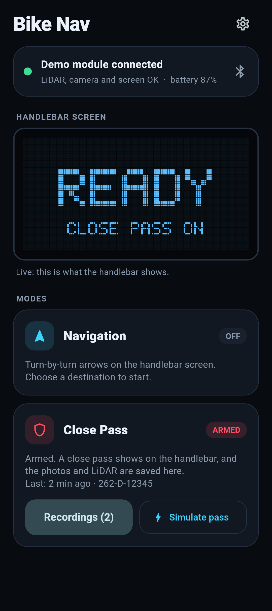
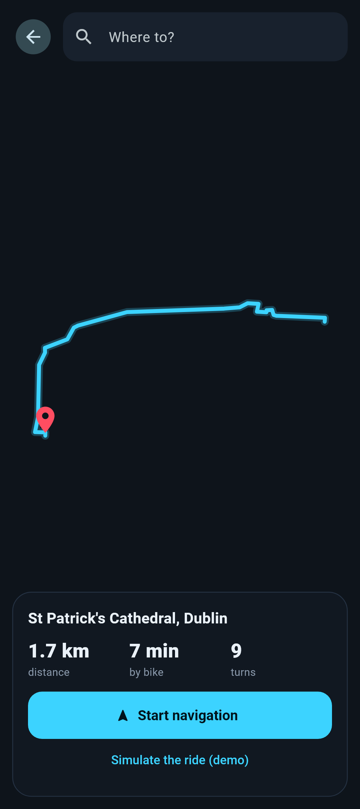
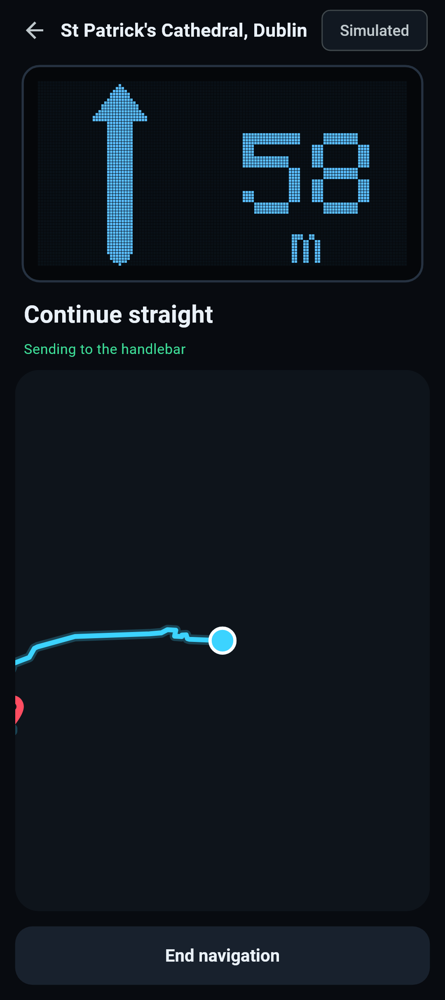
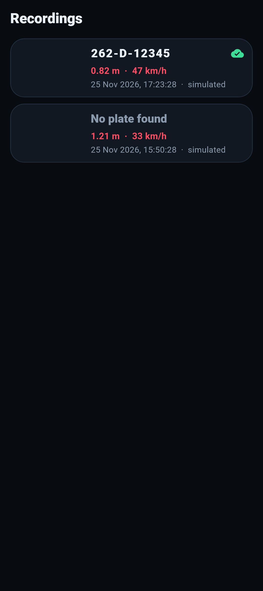
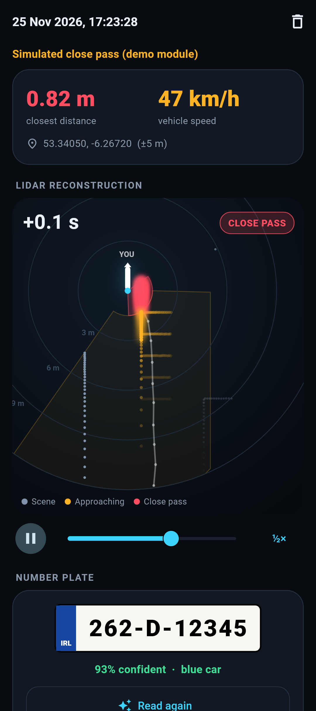
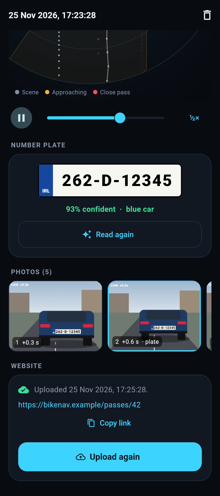
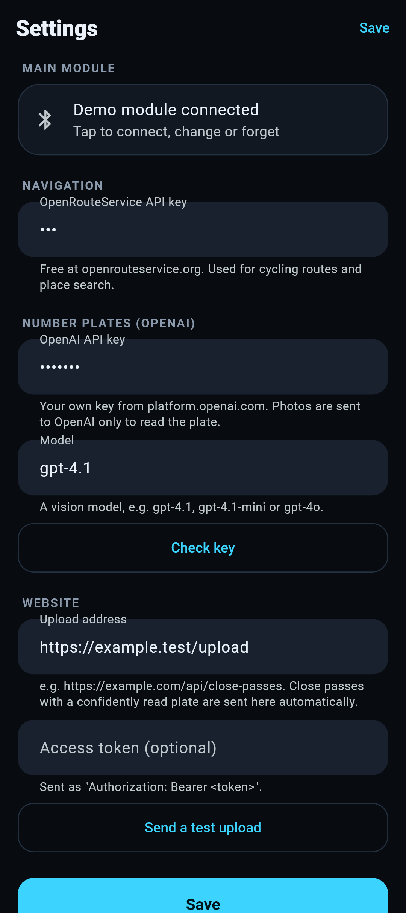

# Phone App: Specification

| | |
|---|---|
| **Module** | Phone App ("Bike Nav") |
| **Runs on** | Android phone (built and laid out for a Google Pixel 9a; needs Android 7.0 / API 24 or newer, 64-bit, with Bluetooth LE) |
| **Language** | Dart / Flutter 3.50.1 |
| **Install file** | [`release/BikeNav.apk`](release/BikeNav.apk), version 1.0.2, 18.9 MB, SHA-256 `1f94a9fef8a45f77789eb24d87bd57e633e7dfb5bc31584b6829ce9903f7f691` (see section 6) |
| **Status** | **App complete and tested in software (87 automated tests pass).** It works end to end with the built-in demo Main Module. **Not yet tested with real hardware:** the Main Module's Bluetooth side is written (firmware v1.14, section 8) but not yet run on the board; the Front Module's frame display isn't built yet (section 9). Plate reading needs your OpenAI key; uploading needs the website address. |

## 1. What the app does

The app has two modes and talks to one thing on the bike, the **Main Module**, over Bluetooth LE.

| Mode | When | Input | Output |
|------|------|-------|--------|
| **Navigation** | Turned on by choosing a destination and tapping Start | The phone's own GPS + cycling routes from OpenRouteService | **Only** compressed 128x64 images of the handlebar screen, sent to the Main Module, which passes them straight to the Front Module. Nothing comes back from the bike. |
| **Close Pass** | Always on while the Main Module is connected | Alert + package (≈5 photos + LiDAR clip) from the Main Module | 1) "CLOSE PASS" on the handlebar screen (only when navigation is off); 2) the incident saved in **Recordings** with a LiDAR replay; 3) the number plate read with OpenAI; 4) plate, photos and pass data uploaded to the website |

```
                      ┌──────────────── Phone (Bike Nav) ────────────────┐
 GPS ───────────────▶ │ Navigation ── renderOled ─┐                      │
 OpenRouteService ──▶ │                           ├─▶ DisplayController ─┼─BLE─▶ Main Module ─ESP-NOW─▶ Front Module
                      │ Close Pass alert ─────────┘   (what the screen   │      (forwards frames as-is)   (shows them)
                      │                                shows)            │
 Main Module ──BLE──▶ │ Close Pass package ─▶ Recordings ─▶ OpenAI ─▶ Website upload
                      └──────────────────────────────────────────────────┘
```

### 1.1 Screens

| Screen | What's on it |
|--------|--------------|
| **Home** | Main Module connection card (tap to connect; since 1.0.2 its sheet also shows how often the link has dropped and Android's reason for the last drop, e.g. "link timed out (code 8)"); live **handlebar screen preview**, pixel for pixel what is sent; Navigation card (status, next instruction, Open/End); Close Pass card (Armed/Waiting, last incident, Recordings; with the demo module also **Simulate pass**). A red banner and a vibration appear when a close pass is detected. |
| **Connect** (bottom sheet) | Scans for "BikeNav Main", tap once to connect. The module is remembered and reconnected automatically after that. Disconnect / Forget. "No hardware? Use the demo module". |
| **Navigation** | Planning: dark map, "Where to?" search (Ireland), or long-press the map; route card with distance, time and turns; **Start navigation**; "Simulate the ride (demo)". Riding: big handlebar preview, the next instruction ("then …" for a second close turn), whether frames are being sent, the map following the rider, End/Done. |
| **Recordings** | Every close pass, newest first: best photo, plate, distance and speed, time, upload state. |
| **Incident** | Distance, vehicle speed and location; **animated LiDAR reconstruction** (play/pause, scrub, ¼×/½×/1×); the plate drawn as a plate with confidence and vehicle description; "Read plate / Read again"; the photos (tap to zoom, the best plate photo highlighted); website upload state, "Upload to website", copy link; delete. |
| **Settings** | Main Module; OpenRouteService key + **Check routing key**; OpenAI key + model + **Check OpenAI key**; website upload address + token + **Send a test upload**; licences. |

### 1.1.1 Screenshots

Rendered at Pixel 9a size by `test/zz_screenshots_test.dart` (maps are shown without their street tiles in these offline renders). Files are in [`docs/screenshots/`](docs/screenshots/).

| Home | Planning | Riding | Recordings |
|---|---|---|---|
|  |  |  |  |

| LiDAR replay | Plate, photos, upload | Settings |
|---|---|---|
|  |  |  |

### 1.2 Navigation mode

- Built on the existing `navigation/` package (tasks N1–N7): OpenRouteService cycling route, GPS snapped to the route, the next turn always shown (`TriggerMode.always`), close turns shown as a pair, flash at 5 m, off-route detection and automatic rerouting (at most every 15 s).
- After every GPS fix, `renderOled` draws the exact 128x64 screen. `DisplayController` sends it if it changed, and re-sends it every 3 s so a Front Module that restarted catches up.
- While navigating, close passes are **still recorded and processed**, but the handlebar keeps showing directions (the user's rule).
- Before the first GPS fix the handlebar shows "ROUTING".

### 1.3 Close Pass mode

1. **Alert** (`0xA1`) → if navigation is off, the handlebar shows `CLOSE PASS` in large letters with "0.8 M  42 KM/H" underneath, flashing for 1.5 s and staying for 6 s, then back to `READY`. The phone records the time and its GPS position (without asking for permission mid-ride) and vibrates.
2. **Package** (transfer kind 1) → saved under the app's private storage: `incidents/<id>/incident.json`, `photo_N.jpg`, `lidar.bin`. If the module didn't send distance or speed, the phone works them out from the LiDAR clip.
3. **Plate reading** → the photos go to OpenAI Chat Completions (`gpt-4.1` by default, configurable) with an engineered prompt and a strict JSON schema (section 4). The result is checked against Irish, UK and NI plate formats.
4. **Upload** → automatic if a plate was read **confidently** (found, no "?" characters, confidence ≥ 0.5) and a website address is set. Anything else can be uploaded by hand from the incident screen. Failed or waiting jobs resume when the app starts or Settings are saved.

### 1.4 LiDAR reconstruction (`ClipAnalysis` + `LidarReplay`)

From the clip the phone works out the **closest distance** (nearest close-pass return, else nearest vehicle return), the **pass speed** (last estimate before the pass), the **vehicle's track** (centre of its returns in each scan) and a view box. The replay draws, top-down with the bike at the centre: range rings (3/6/9/12 m), the approach zone (amber) and the 1.5 m close zone (red, lit up during the pass), fading trails of earlier scans, the vehicle's path, glowing close and approach returns, and, after it happens, a dashed line and label at the closest approach. Badges show "APPROACHING · 38 km/h" and "CLOSE PASS"; the time is shown relative to the pass.

## 2. Folder layout

```
Phone App/
├── SPECIFICATION.md            ← this file
├── release/BikeNav.apk         ← install file (arm64 Android phones)
├── docs/
│   ├── website_upload.md       ← exact upload contract + a ready-to-run example server
│   ├── navigation.md           ← routing design notes (N1-N7), provider comparison, screens
│   └── images/oled_screens.png
├── navigation/                 ← pure Dart package bike_navigation (testable on a laptop)
│   └── lib/src/  engine.dart, session.dart, ors_client.dart, route.dart, geo.dart,
│                 junctions.dart, symbols.dart, replay.dart (unchanged logic)
│                 oled.dart          draws every handlebar screen (+ close-pass, idle, message)
│                 display_codec.dart frame → row-major → row-XOR → PackBits → display packets
└── app/                        ← the Flutter app
    ├── lib/
    │   ├── main.dart, app.dart              start-up, AppServices (wiring), AppScope
    │   ├── settings.dart                    keys, model, website, remembered module
    │   ├── link/
    │   │   ├── protocol.dart                ★ BLE protocol v1: UUIDs, messages, CRC-32, transfers
    │   │   ├── close_pass_package.dart      ★ close-pass package + LiDAR clip format
    │   │   ├── main_module.dart             connection, reconnect, frame sending, reassembly, ACKs
    │   │   ├── ble_finder.dart              flutter_blue_plus scanning/connecting
    │   │   ├── transport.dart               byte-pipe interface (BLE, demo, tests)
    │   │   ├── demo_main_module.dart        in-app Main Module speaking the same protocol
    │   │   └── demo_scene.dart              ray-cast LiDAR scene of a car passing too close
    │   ├── navigation/nav_controller.dart   plan → preview → ride, GPS or simulated
    │   ├── display/display_controller.dart  what the handlebar shows, and sending it
    │   ├── closepass/                       incident, store, clip_analysis, plate_reader (OpenAI),
    │   │                                    uploader (website), close_pass_service (pipeline)
    │   ├── services/                        location (GPS), place_search (ORS geocoding)
    │   └── ui/                              screens, theme, demo photos, widgets (lcd_preview,
    │                                        lidar_replay, route_map)
    ├── test/                                51 app tests (see section 7)
    └── android/                             permissions, app id ie.tcd.design.bike_app
```

## 3. Bluetooth LE: what the app expects from the Main Module (contract)

**This is the contract the Main Module firmware must implement** (plain-English instructions in section 8). The reference code is `app/lib/link/protocol.dart` and `close_pass_package.dart`; the display format is in `navigation/lib/src/display_codec.dart`. All numbers are **little-endian**. Protocol version **1**.

### 3.1 GATT

| | UUID | Properties |
|---|---|---|
| Service | `6e3b2000-8f7a-4c1e-9b52-2d1c0b7a1f10` | advertised |
| Phone → Main | `6e3b2001-8f7a-4c1e-9b52-2d1c0b7a1f10` | Write, Write Without Response |
| Main → Phone | `6e3b2002-8f7a-4c1e-9b52-2d1c0b7a1f10` | Notify |

Advertised name **`BikeNav Main`**. The phone finds the module by the service UUID or a name starting with "BikeNav", and asks for MTU 512. No PIN or bonding: "pairing" is choosing the module once in the app.

### 3.2 Phone → Main Module

| Type | Bytes | Meaning |
|------|-------|---------|
| `0x10` display chunk | `[0x10][frame# u8][chunk index u8][chunk count u8][flags u8][data…]` | Part of a compressed screen. **Forward unchanged to the Front Module.** flags bit 0 = flash (invert 4×/s). Data ≤ 180 bytes (≤ MTU−8) |
| `0x30` ack | `[0x30][transferId u16][status u8]` | 0 = package received OK; 1 = damaged, please send it again |
| `0x40` hello | `[0x40][version u8 = 1]` | Sent once after connecting. Reply with a status message |

### 3.3 Main Module → Phone (notifications)

| Type | Bytes | Meaning |
|------|-------|---------|
| `0xA1` close-pass alert | `[0xA1][eventId u16][minDistanceMm u16][speedKmh×10 u16]` | Send **immediately** when a close pass is detected. `0xFFFF` = unknown |
| `0xB1` transfer start | `[0xB1][transferId u16][kind u8 = 1][totalLength u32]` | A close-pass package follows |
| `0xB2` transfer data | `[0xB2][transferId u16][offset u32][bytes…]` | Up to MTU−3−7 bytes of the package per notification |
| `0xB3` transfer end | `[0xB3][transferId u16][crc32 u32]` | CRC-32 of the whole package (zlib/Ethernet CRC: `crc32("123456789") = 0xCBF43926`) |
| `0xC1` status | `[0xC1][flags u8][battery % u8, 255 = unknown][fw major u8][fw minor u8]` | flags bit 0 LiDAR OK, bit 1 camera OK, bit 2 Front Module OK. Optional; the app shows ✓/✗ |

### 3.4 Close-pass package (transfer kind 1)

| Offset | Size | Field |
|--------|------|-------|
| 0 | 4 | magic `"CPK1"` |
| 4 | 2 | eventId (same as the alert) |
| 6 | 4 | eventUptimeMs (`millis()` at detection) |
| 10 | 2 | minDistanceMm (`0xFFFF` = unknown) |
| 12 | 2 | speedKmh×10 (`0xFFFF` = unknown) |
| 14 | 1 | photoCount N (≈5) |
| 15 | 1 | reserved 0 |
| 16 | … | N × { i32 offsetMs (photo time − event time), u32 length L, L bytes JPEG } |
| … | 2+2 | LiDAR clip: u16 scanCount S, u16 reserved 0 |
| … | … | S × { i32 offsetMs, u8 flags (bit0 close, bit1 approaching), u16 speedKmh×10 (`0xFFFF` none), u16 pointCount P ≤ 1024, P × { i16 x mm, i16 y mm, u8 class 0/1/2 } } |

Points use the Main Module's coordinates: x = right, y = forward, LiDAR at (0, 0); class 0 normal, 1 close-pass return, 2 approaching-vehicle return (the same 5-byte points as its existing `LIVE` USB output). A good clip is about **2 s before to 1.5 s after** the pass at 10 scans/s.

### 3.5 Handlebar frame format (`display_codec.dart`)

1. 128x64 pixels → 1024 bytes, row by row, 16 bytes per row, **MSB = leftmost pixel**, 1 = lit (Adafruit `drawBitmap` layout).
2. **Row XOR:** each byte of rows 1-63 XOR the byte directly above it (row 0 unchanged).
3. **PackBits:** header h 0-127 → copy the next h+1 bytes; h 129-255 → repeat the next byte 257−h times; 128 → skip.
4. Cut into ≤ 180-byte chunks, each sent as a `0x10` packet.

Measured on all 415 test screens: **average 208 bytes, largest 429 bytes** (from 1024), so 1-3 packets per screen. `dart run tool/export_screens.dart out/` in `navigation/` writes every screen as hex packets plus text art, as test vectors for the firmware.

## 4. Number-plate reading (OpenAI)

| | |
|---|---|
| Endpoint | `POST https://api.openai.com/v1/chat/completions` with `Authorization: Bearer <your key>` |
| Model | Settings → Model, default **`gpt-4.1`** (any vision model with structured outputs: `gpt-4.1-mini`, `gpt-4o`, …). **Check OpenAI key** calls `GET /v1/models/<model>` |
| Input | System prompt + a short text (time, LiDAR distance and speed, each photo's time) + every photo as a base64 data URL, `detail: high` |
| Output | Strict JSON schema: `plate_found, plate, plate_country (IE/UK/OTHER/UNKNOWN), confidence, best_image, vehicle_type, vehicle_colour, vehicle_make, notes` |
| Cost | About 5 × 255 image tokens + ~900 text tokens per close pass |

The prompt (in `plate_reader.dart`) explains what happened (left-hand traffic, so the overtaker passes on the **right**, photos in time order after the pass), how to **pick the overtaking vehicle** (closest and largest moving vehicle, in several consecutive photos, getting further away; ignore parked, oncoming and distant vehicles and the bike), how to **read and combine** characters across photos, the **Irish format** with every county code, UK and NI formats, look-alike characters, and that it must **never invent characters** (use `?`) and give an honest confidence. The app then normalises the plate (`241 d 12345` → `241-D-12345`), checks the format and treats it as **confident** only if found, without `?`, and confidence ≥ 0.5.

Clear messages for: no key, wrong key (401), model not available (404), out of credits or rate limited (429), OpenAI down (5xx), refusal, no internet.

## 5. Website upload

`POST <upload address>` as `multipart/form-data`, optional `Authorization: Bearer <token>`. The parts are `incident` (JSON), `image` (the best plate photo), `photos` (all of them) and `lidar` (the clip). Any 2xx is success; a JSON reply with `url` shows as a link in the app. **The full contract and a 40-line example server are in [`docs/website_upload.md`](docs/website_upload.md).** To hook up the website, paste its address into Settings and tap **Send a test upload**.

## 6. Install on the Pixel 9a

1. On the phone, open this repository on GitHub, go to `Phone App/release/BikeNav.apk` and tap **Download** (or copy the file over USB).
2. Open the downloaded file. Android asks to allow installing from this source (Chrome or Files): allow it, go back and tap **Install**. Google Play Protect may warn that it doesn't know the app; choose **Install anyway**. This happens because the app is self-signed rather than from the Play Store.
3. Open **Bike Nav** and allow **Location** and **Nearby devices** (Bluetooth) when asked.
4. **Settings** → paste the **OpenRouteService** key and tap **Check routing key**; paste your **OpenAI** key and tap **Check OpenAI key**; then **Save**. Add the website address later.
   - **Getting the routing key (free, no card):** sign up at [account.heigit.org](https://account.heigit.org) (HeiGIT runs OpenRouteService), then copy the key from the dashboard. Older keys from openrouteservice.org still work.
   - **The map needs no key.** It uses OpenStreetMap tiles, darkened on the phone.
5. Home → tap the Main Module card → tap **BikeNav Main** (or **Use the demo module** to try everything without hardware: then **Simulate pass** on the Close Pass card, or **Simulate the ride** in Navigation).

**With USB debugging:** `adb install -r "Phone App/release/BikeNav.apk"`.

**Signing:** the APK is signed with a debug key, which is fine for installing directly. Android only installs an update over an existing copy if both were signed with the same key. If a later APK was built on a different computer, uninstall the old app first (this deletes its recordings and settings). For lasting releases, create one release key and keep it out of GitHub.

**Building it yourself:** Flutter 3.50.1, then in `Phone App/app`: `flutter build apk --release --target-platform android-arm64`. Optional build-time defaults: `--dart-define=ORS_API_KEY=… --dart-define=OPENAI_API_KEY=… --dart-define=UPLOAD_URL=…`. **Don't use these defines for an APK you share**: the keys would be inside it.

**Keys are never in the code or the APK.** They are typed into Settings and stored only in the app's private storage, and Android backup is switched off for the app.

## 7. Tests

| Suite | Command | What it checks |
|-------|---------|----------------|
| navigation (36) | `cd "Phone App/navigation"; dart test` | Routing logic N1-N7, screens, close-pass/idle screens, row-major layout, row-XOR, PackBits (incl. the Apple TN1023 vector), packets round-trip for every screen, out-of-order chunks |
| app (51) | `cd "Phone App/app"; flutter test` | Protocol bytes (CRC vector, alert/status encodings, transfers in any order, missing/corrupt/oversize), package and clip round-trip and damage, LiDAR demo scene and reconstruction maths, connection (hello/status, frames pixel-exact at the module, newest-frame-wins, resend after reconnect, damaged transfer re-requested, remember + auto-reconnect + stop on disconnect), display rules (idle, alert, flash timing, back to idle, keep-alive, navigation keeps the screen), a full simulated Dublin ride with every frame checked, the full close-pass pipeline (alert → incident → plate → upload, saved to disk and reloaded), unsure/no plate, no key/website then resume, errors, OpenAI request and prompt structure, parsing and every error, plate formats, multipart upload contents, the new routing addresses, **the Main Module firmware's own notifications** (`firmware_vectors_test.dart`: alert, status and a full close-pass package at MTU 23/185/247/517, generated from `main_module.ino` by `Tools/Phone Link Test/`), and widgets at Pixel 9a size |

Not covered by tests: real Bluetooth radio behaviour, real GPS, live OpenRouteService/OpenAI/website calls (all need hardware, keys or the website), and how the app looks on the actual phone.

## 8. To add to the Main Module (plain-English brief for whoever writes it)

> **Built in Main Module firmware v1.25** (on the team's reconstructed v1.21; installed on the board as v1.26) (`Main Module/main_module.ino`; how it works: `Main Module/SPECIFICATION.md` sections 1.6 and 2.3, bench test in section 8). Not yet run on hardware. Its bytes are checked against this app's decoder by `test/firmware_vectors_test.dart` (vectors from `Tools/Phone Link Test/`). The list below is the brief it was built from; `app/lib/link/demo_main_module.dart` is the same behaviour in Dart.

1. **Add a Bluetooth LE server** (NimBLE-Arduino is the lightest choice on ESP32). Advertise the service UUID `6e3b2000-…` in the advertising packet and the name **"BikeNav Main"** in the scan response. Create the two characteristics from section 3.1. Accept MTU up to 512. Restart advertising when the phone disconnects. No pairing PIN is needed.
2. **Keep ESP-NOW working alongside Bluetooth.** The camera link must keep using Wi-Fi channel 6. ESP32 can run BLE and ESP-NOW together (software coexistence), but test the photo transfer speed with BLE connected.
3. **Forward screens to the Front Module.** Every write starting with `0x10` must be sent **unchanged** by ESP-NOW to the Front Module (add its MAC address as a second peer on channel 6, next to the camera). Don't decode or change it. If the phone disconnects for more than 10 s, optionally send the Front Module a "NO PHONE" frame (or let the Front Module time out by itself).
4. **Hello and status.** When `0x40` arrives, reply with a `0xC1` status: LiDAR OK if a scan arrived in the last second, camera OK if the last photo request was answered, Front Module OK if the last ESP-NOW send to it succeeded. Battery 255 if not measured. Firmware version e.g. 1.14. Sending status every 10 s is a bonus.
5. **Close-pass alert.** When the detector sets `newClose`, notify `0xA1` immediately with an event number (+1 each time), the closest distance (smallest distance of the close-pass points, mm) and the latest approach speed (km/h × 10, or `0xFFFF`).
6. **Photos.** Change the burst to **5 photos** (`burstShots = 5`; the phone accepts any number). Keep the JPEGs in memory (heap or PSRAM; QVGA JPEGs are about 8-20 KB) instead of only streaming them to USB. Keep the USB output for the Mac viewer if wanted.
7. **LiDAR clip.** Keep a ring buffer of the last **~2 s of processed scans** (points with their class 0/1/2, flags and approach speed, as already produced for `LIVE`), and keep recording **~1.5 s after** the event. To save memory, downsample to at most ~300 points per scan.
8. **Build the package** in the layout of section 3.4 once the burst is done and the after-event recording ends.
9. **Send it** with `0xB1` start, `0xB2` data parts (size ≤ MTU−10), then `0xB3` end with the CRC-32 (`esp_rom_crc32_le` with the standard settings, or a small table; check it with "123456789" → `0xCBF43926`). Pace notifications so the BLE stack's queue doesn't overflow (wait for the "notify sent" callback, or a few ms between parts).
10. **Wait for the ack** `0x30`: status 0 → free the memory; status 1 or no ack within 5 s → send the whole package again (at most 2 more times). If the phone isn't connected, keep the latest package and send it when the phone reconnects.
11. **Memory and flash.** The current sketch already uses 71% of the default 1.3 MB app partition. NimBLE adds roughly 100-200 KB. Choose a bigger app partition (e.g. "Huge APP (3MB No OTA)" or "Minimal SPIFFS") in Tools → Partition Scheme.
12. **Test with the phone app:** connect from the app, check the ✓ marks, use the camera test, trigger a close pass, check the photos, replay and distance in Recordings.

## 9. To add to the Front Module (plain-English brief)

> **Built in Front Module firmware v1.21, installed as v1.22** (which also rotates the screen 180°; `Front Module/front_module.ino`, section 1.2 of its spec). Its decoder is checked against all 415 screens from `navigation/tool/export_screens.dart` by `Tools/Phone Link Test/`.

1. Receive ESP-NOW packets from the Main Module (accept only the Main Module's MAC).
2. For packets starting with `0x10`: collect the chunks of one frame number (bytes 1-3: frame#, index, count); a different frame number starts over.
3. When all chunks are in: join them in index order, **PackBits-decode** them (section 3.5, step 3), check you got exactly 1024 bytes, **undo the row XOR** (for i = 16 … 1023: `buf[i] ^= buf[i-16]`), then `display.clearDisplay(); display.drawBitmap(0, 0, buf, 128, 64, SSD1306_WHITE); display.display();`.
4. If flags bit 0 is set, toggle `display.invertDisplay()` every 125 ms until a frame without the flag arrives.
5. If nothing arrives for 10 s, show "NO PHONE" (or keep the last screen).
6. Test vectors: run `dart run tool/export_screens.dart out` in `Phone App/navigation`. `out/packets.txt` has the exact packets the phone sends for 415 screens, and `out/dart.txt` shows what each must look like.

## 10. Known gaps and next steps

1. **Hardware link not yet tried:** the Main Module side (section 8) is written and installed (firmware v1.26) but hasn't been tried with the phone yet; the Front Module side (section 9) is installed (Front v1.22) but not yet seen working end to end. Until then, the demo module exercises the identical code path.
2. **Screen off / app in background:** while **navigating**, GPS runs as a foreground service (a "Bike Nav is navigating" notification), so directions keep going to the handlebar with the screen off. **Close Pass mode on its own** (not navigating) only runs while the app is open or recently used. Android may pause it in the background, so for rides without navigation keep the app open, or add a foreground service for the Bluetooth link (task P6).
3. **Live services untested from here:** real OpenRouteService routes (OpenRouteService moved to `api.heigit.org` on 24 Nov 2026; the app uses the new address, which was checked to answer, but not with a real key) (a saved Dublin route is used in tests), OpenAI plate reading on real camera photos, and the website (not built yet).
4. **Plate reading is only as good as the photos:** QVGA (320×240) photos of a moving car are small, so the camera resolution may need raising for reliable plates. The app reports honest confidence and never auto-uploads an unsure plate.
5. **Licences:** flutter_blue_plus is used under its **non-profit/educational** licence (`License.nonprofit`); a commercial product needs its paid licence. Map tiles come from the OpenStreetMap tile server (© OpenStreetMap contributors). Its usage policy allows light use like this app's as long as the app identifies itself and shows attribution, both of which it does. A product with many users must switch to a paid or self-hosted tile provider.
6. Demo photos show a made-up plate (`262-D-12345`), and demo incidents are marked "simulated" in the app and in uploads.

## 11. Notes for AI assistants

- Protocol and format changes must be made **in the same commit** to `protocol.dart` / `close_pass_package.dart` / `display_codec.dart`, this spec (sections 3, 8, 9), the Main and Front Module specs, and the tests. `demo_main_module.dart` must keep behaving like the real Main Module.
- `navigation/` must stay free of Flutter imports.
- Keep the app minimal: two modes, Recordings, Settings. Don't add features without being asked.
- Never put API keys in code, build files or the APK you commit.
- Run `dart test` (navigation) and `flutter test` (app) before committing. On Windows, build Flutter from a short path (for example `D:\…`).
